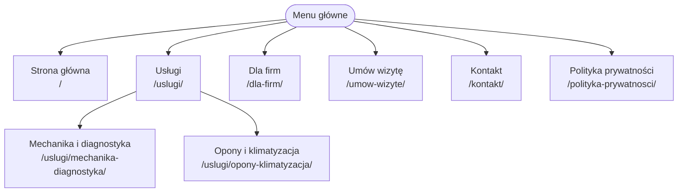

# Auto-Serwis Waldi

*Nazwa* - Auto-Serwiss Waldi
*Oferta* - Naprawa oraz diagnostyka samochodów osobowych i dostawczych do 3.5t
*Grupa docelowa* - Klienci prywatni oraz małe firmy.

## Persony
### Klient prywatny
- **Cel** - Umówić się na diagnostykę, kontrolki silnika.
- **Problem** - Nie ma czasu zadzwonić w godzinach pracy warsztatu.
- **Urządzenie** - smartfon.
- **CTA** - **"Umów wizytę online"**

### Klient flotowy
- **Cel** - Partnerstwo z warsztatem który będzie dbał o flotę.
- **Problem** - Samochody jeżdżą do różnych warsztatów, co stwarza problemy z organizacją.
- **Urządzenie** - Komputer w biurze.
- **CTA** - **"Zapytaj o ofertę dla firm"**

## Mapa strony

## Dlaczego WordPress
Super popularny, słyszałem i spotkałem się z WordPressem, jeszcze zanim rozpocząłem studia. Z doświadczenia z Open Source, za popularnością idzie także bezpieczeństwo i ilość motywów/pluginów. Łatwość uruchomienia i konfiguracji.

## Użycie AI w projekcie
- **Pomoc** - Ogólna pomoc oraz wygenerowanie pliku `.svg`.