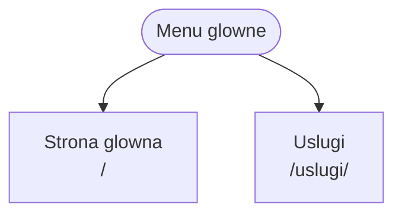

# Auto-Serwis Waldi

*Nazwa* - Auto-Serwiss Waldi
*Oferta* - Naprawa oraz diagnostyka samochodow osobowych i dostawczych do 3.5t
*Grupa docelowa* - Klienci prywatni oraz male firmy.

## Persony
### Klient prywatny
- ** Cel ** - Umowic sie na diagnostyke, kontrolki silnika.
- ** Problem ** - Nie ma czasu zzadzwonic w godzinach pracy warsztatu.
- ** Urzadzenie ** - smartfon.
- ** CTA ** - ** "Umow wizyte online" **

### Klient flotowy
- ** Cel ** - Partnerstwo z warsztatem ktory bedzie dbal o flote.
- ** Problem ** - Samochody jezdza do roznych warsztatow, co stwarza problemy z organizacja.
- ** Urzadzenie ** - Komputer w biurze.
- ** CTA ** - ** "Zapytaj o oferte dla firm" **

## Mapa strony

