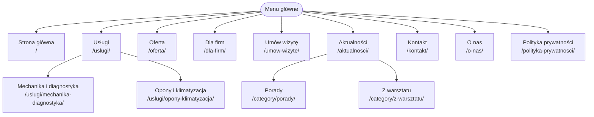

# Auto-Serwis Waldi

Projekt strony warsztatu samochodowego na WordPressie. Oferta: naprawa i diagnostyka samochodów osobowych i dostawczych do 3.5t. Klienci: prywatni oraz małe firmy.

## Persony

### Klient prywatny
Chce umówić się na diagnostykę, bo zapaliła mu się kontrolka silnika. Nie ma czasu dzwonić w godzinach pracy warsztatu, więc wchodzi na stronę ze smartfona. CTA: „Umów wizytę online”.

### Klient flotowy
Szuka warsztatu, który zajmie się całą flotą, zamiast wozić auta po różnych miejscach i gubić się w organizacji. Wchodzi z komputera w biurze. CTA: „Zapytaj o ofertę dla firm”.

## Mapa strony


## Struktura treści
Bezpośrednie odnośniki: `/%postname%/` (sama nazwa wpisu). Strona główna jest statyczna (`/`), a wpisy wylądowały na stronie Aktualności (Ustawienia > Czytanie). Kategorie: Porady i Z warsztatu. Wpisy: „Kontrolka check engine – co oznacza i co zrobić?” oraz „Przygotuj auto do zimy” w Poradach, „Rezerwacja wizyt online – wkrótce” w Z warsztatu.

## Strona główna (według `wireframe.svg`)

| Sekcja | Bloki |
|---|---|
| Hero | Okładka → Tytuł (H1), Akapit, Przyciski (CTA „Umów wizytę online”) |
| Usługi i korzyści | Grupa → H2, Kolumny (3 × karta: H3, Lista, link) – wcześniej Tabela, zamieniona po audycie WAVE (*Layout table*) |
| Opinie klientów | Grupa → H2, Kolumny (3 × Grupa-karta z Cytatem) – przykładowe opinie, oznaczone na stronie jako wygenerowane przez AI |

Na stronie jest jeden H1, a kolejność nagłówków to H1 → H2 → H3. Użyłem szablonu „Strona bez tytułu”, żeby tytuł strony nie dublował H1.

## Nagłówek, stopka i wzorzec
W nagłówku logo z nazwą witryny, menu główne (Strona główna, Usługi z podstronami, Dla firm, Aktualności, Kontakt) i przycisk „Umów wizytę”. Stopka: nazwa i slogan, dane kontaktowe (adres, telefon, e-mail, godziny otwarcia) oraz „Menu stopki” z linkiem do Polityki prywatności.

Wzorzec „Hero – Auto-Serwis Waldi” (kategoria Auto-Serwis, niez synchronizowany) zapisałem z Okładki strony głównej i wstawiłem na stronie **Oferta** (`/oferta/`). Blok Tytuł w Okładce pokazuje tytuł danej strony jako H1, więc wzorzec pasuje też tam.

## Dlaczego WordPress
Super popularny, słyszałem i spotkałem się z WordPressem, jeszcze zanim rozpocząłem studia. Z doświadczenia z Open Source: za popularnością idzie bezpieczeństwo i ilość motywów/pluginów. No i łatwość uruchomienia i konfiguracji.

Według W3Techs (październik 2026) WordPress napędza 40,2% wszystkich stron i ma 58,7% rynku CMS – dla porównania Wix 6,1%, Shopify 7,8%, Drupal 0,6%. Wix i Shopify to SaaS: abonament, mniej kontroli i uzależnienie od dostawcy, a Drupal pasuje do dużych portali i sektora publicznego, nie do strony lokalnego warsztatu. Dlatego WordPress: darmowy, self-hosted, z ekosystemem, który już znam.

## Użycie AI w projekcie
Narzędziem był Claude Code (Anthropic) – asystent w terminalu z dostępem do repozytorium i lokalnego WordPressa.

Osobiście zrobiłem: persony, mapę strony, układ strony głównej (Okładka ze zdjęciem, usługi, opinie), wybór palety (mój motyw Spectagon) i zdjęć z Pexels, ocenę kolejnych wersji i poprawki wyglądu (m.in. odrzuciłem pierwszą wersję strony głównej; wyśrodkowanie i rozmiar tekstu na stronie Usługi), audyt WAVE, przegląd i akceptację zmian.

AI użyłem do:
- wygenerowania pliku `wireframe.svg` i ogólnej pomocy,
- tekstów pomocniczych: 3 wpisów w Aktualnościach, opisów na stronach Usługi, Oferta i Kontakt, szkicu polityki prywatności (do weryfikacji – firma i dane są fikcyjne),
- przykładowych opinii klientów (oznaczonych na stronie),
- kodu: pliku wzorca `patterns/hero-cta.php`, `theme.json`, Dodatkowego CSS, formularza CF7 z komunikatami,
- obliczeń kontrastu, uruchomienia Lighthouse (pliki w [`raport/`](raport/), podsumowanie [`lighthouse-podsumowanie.md`](raport/lighthouse-podsumowanie.md)) i poprawek zgłoszonych przez Lighthouse/WAVE,
- pomocy w redakcji tego README (tabele, lista źódeł, opis B1).

Później, przy kończeniu projektu, użyłem agenta w terminalu (Hermes): poprawił separator dziesiętny (3.5 t → 3,5 t) w bazie eksportu ZIP, przepakował eksport, zredagował formatowanie tego README i raportu dostępności (treść liczbowa bez zmian), wygenerował ponownie PDF raportu, odświeżył zrzuty strony głównej i Oferty oraz przeprowadził automatyczny test struktury drzewa dostępności (B2). Słuchowy test VoiceOver zrobiłem sam.

Każdą zmianę sprawdzałem w przeglądarce i na zrzutach ekranu (komputer i telefon). Wyniki audytów są w [`raport/`](raport/) (opis zawartości: [`raport/README.md`](raport/README.md)). Plik `raport/lighthouse/pierwszy-testowy-pomiar.html` to mój pierwszy, testowy pomiar stanu po zmianach.

## Style globalne i kontrast (L3 G1)
Paleta bierze się z mojego motywu terminala/edytora **Monokai Pro Spectagon** (ciemne tło Spectrum i akcenty Octagon, plik `nixconfig-global`). Pomarańcz marki pasuje do zdjęcia warsztatu. Ten sam zapis jest w [`theme.json`](theme.json) (przyda się do motywu w L4).

| Kolor | Slug | Wartość |
|---|---|---|
| Tło | `base` | `#222222` |
| Tekst | `contrast` | `#EAF2F1` |
| Marka (pomarańcz) | `accent-1` | `#FF9B5E` |
| Tekst drugorzędny | `accent-4` | `#B2B9BD` |
| Akcent – tło kart | `accent-5` | `#363537` |
| Obramowania (techniczny) | `accent-6` | `#696D77` |

Kontrast liczyłem dla każdej pary tekst/tło:

| Para tekst / tło | Kolory | Kontrast | WCAG AA |
|---|---|---|---|
| Nagłówki / tło | `#EAF2F1` / `#222222` | 13,99:1 | spełnia |
| Tekst akapitu / tło | `#B2B9BD` / `#222222` | 8,01:1 | spełnia |
| Tekst w kartach opinii / tło kart | `#B2B9BD` / `#363537` | 6,14:1 | spełnia |
| Przycisk: tekst / kolor marki | `#222222` / `#FF9B5E` | 7,65:1 | spełnia |
| Stopka: tekst / tło | `#EAF2F1` / `#131313` | 16,34:1 | spełnia |
| Obramowania / tło (element UI, wymóg 3:1) | `#696D77` / `#222222` | 3,07:1 | spełnia |
| Okładka: biały tekst / nakładka | `#FFFFFF` / `#393232` (70%) | 12,53:1* | spełnia |

Przycisk wymagał jedynego kompromisu: jasny tekst na pomarańczu nie osiągnąłby 4,5:1, więc tekst przycisku zrobiłem ciemny.

\* dla samej nakładki; na jaśniejszych fragmentach zdjęcia kontrast jest niższy – sprawdzić w Lighthouse (G3).

## Źródła i licencje materiałów (L3 G4)

| Materiał | Gdzie użyty | Autor | Licencja | Link |
|---|---|---|---|---|
| Zdjęcie „Mechanicy przy samochodach w warsztacie” | Okładka strony głównej, strona Oferta, wzorzec `hero-cta` | Quentin Martinez | [Licencja Pexels](https://www.pexels.com/license/) – darmowe użycie, bez obowiązku podpisu | [pexels.com/photo/33169327](https://www.pexels.com/photo/33169327/) · [autor](https://www.pexels.com/@quentin-martinez-2147503099/) |
| Font Manrope | Cały tekst strony | The Manrope Project Authors | SIL Open Font License 1.1 | [github.com/sharanda/manrope](https://github.com/sharanda/manrope) |
| Font Fira Code | Bloki kodu | The Fira Code Project Authors | SIL Open Font License 1.1 | [github.com/tonsky/FiraCode](https://github.com/tonsky/FiraCode) |
| WordPress | CMS | WordPress.org | GPLv2 lub nowsza | [wordpress.org](https://wordpress.org/) |
| Motyw Twenty Twenty-Five 1.5 | Motyw witryny | the WordPress team | GPLv2 lub nowsza | [wordpress.org/themes/twentytwentyfive](https://wordpress.org/themes/twentytwentyfive/) |
| Wtyczka Contact Form 7 6.2.5 | Formularze | Rock Lobster Inc. | GPLv2 lub nowsza | [contactform7.com](https://contactform7.com/) |
| Wtyczka Bookly 28.8 | **Wyłączona** – niezgodna z bazą SQLite (Playground): instalator tworzy tylko 19 z ok. 34 tabel, kreator konfiguracji kończy się błędem; rezerwacja online „wkrótce” | Nota-Info | GPLv3 | [wordpress.org/plugins/bookly-responsive-appointment-booking-tool](https://wordpress.org/plugins/bookly-responsive-appointment-booking-tool/) |
| Wtyczka SQLite Database Integration 3.1.3 | Baza danych (WordPress Playground) | The WordPress Team | GPLv2 lub nowsza | [wordpress.org/plugins/sqlite-database-integration](https://wordpress.org/plugins/sqlite-database-integration/) |
| Paleta kolorów | Style globalne, `theme.json` | na bazie motywu Monokai Pro (filtr „Spectagon” – własna mieszanka Spectrum + Octagon) | kolory, nie podlegają licencji | – |

Fonty są hostowane lokalnie: Manrope i Fira Code dostarcza motyw (`themes/twentytwentyfive/assets/fonts/`) i ładują się z serwera strony, więc nie ma połączenia z Google Fonts (RODO).

## Dostępny formularz kontaktowy (L3 B1)
Formularz Contact Form 7 na stronie [Kontakt](/kontakt/), zbudowany według startera.

Każde pole ma widoczną etykietę w `<label>`, a wymagane pola są oznaczone tekstem „(wymagane)”, nie tylko gwiazdką czy kolorem; dodatkowo `aria-required="true"`. Pola mają atrybuty `autocomplete` („name”, „email”, „tel”), żeby przeglądarka i czytnik ekranu wiedziały, czego oczekiwać (WCAG 1.3.5 Określenie pożądanego wkładu).

Pole zgody RODO jest domyślnie niezaznaczone i zawiera link do polityki prywatności. Włączyłem `acceptance_as_validation: on`: przycisk „Wyślij” jest zawsze aktywny, a brak zgody daje komunikat błędu. Domyślnie CF7 po prostu wyłącza przycisk, a wyłączony przycisk jest pomijany przez Tab i nie mówi, czego brakuje.

Komunikaty błędów są po polsku i podpowiadają, co poprawić (WCAG 3.3.1, 3.3.3), np. „Wpisz poprawny adres e-mail, np. jan@przyklad.pl.”, „Aby wysłać wiadomość, zaznacz zgodę na przetwarzanie danych.” Kolor błędów zmieniłem z domyślnego `#DC3232` (3,44:1 na tle – poniżej wymaganego 4,5:1) na `#FF657A` (5,6:1), a pole z błędem dostaje grubszą ramkę, żeby informacja nie zależała tylko od koloru.

Walidację sprawdziłem wysłaniem pustego formularza, błędnego e-maila, braku zgody i poprawnych danych. Lighthouse (axe-core) dla strony Kontakt: 100/100. Lokalny kontener nie ma serwera poczty, więc formularz ma `demo_mode: on` (pomija wysyłkę e-maila); na produkcji trzeba to usunąć i skonfigurować SMTP.

Formularz nie wymaga żadnego testu poznawczego (WCAG 3.3.8 Accessible Authentication): nie ma CAPTCHA z przepisywaniem znaków, łamigłówki, zadania matematycznego ani pytania-quizu CF7. Pola da się wypełniać autouzupełnianiem i wklejać do nich tekst. Ochrona przed spamem to na razie lista zabronionych słów z WordPressa (Ustawienia > Dyskusja), którą sprawdza CF7; na produkcji planuję pole-pułapkę (np. wtyczkę „Honeypot for Contact Form 7”) albo Akismet / Cloudflare Turnstile w trybie niewidocznym – żadne z nich nie wymaga od użytkownika testu poznawczego.

Rozmiary celów (WCAG 2.5.8 Target Size): pola tekstowe i przycisk mają min. 44 px wysokości, pole zgody 24×24 px, a link do polityki prywatności jest w tekście zdania (wyjątek „inline” w kryterium). Wszystkie cele mają co najmniej 24×24 px.

## Preferencje użytkownika i skip link (L3 B2)
Dodatkowy CSS ze startera, uzupełniony.

Przy `prefers-reduced-motion: reduce` animacje i przejścia są skrócone do 0,01 ms i nie ma płynnego przewijania (sprawdzone emulacją w DevTools: `scroll-behavior: auto`). W trybie wysokiego kontrastu Windows (`forced-colors: active`) przyciski, pola formularza i karty dostają obramowanie w kolorach systemowych (`ButtonText`, `CanvasText`), a fokus w kolorze `Highlight`. Zrzut z emulacji: [`raport/b2/forced-colors.png`](raport/b2/forced-colors.png).

Skip link „Przejdź do treści” jest pierwszym elementem po naciśnięciu Tab; po fokusie robi się widoczny, a Enter przenosi do `#wp--skip-link--target` (link dodaje sam WordPress, wygląd po fokusie to domyślny styl WordPressa). Zrzut: [`raport/b2/skip-link-po-tab.png`](raport/b2/skip-link-po-tab.png).

- Czytnik ekranu – zamiast testu słuchowego VoiceOver sprawdziłem automatycznie strukturę, którą czytnik odczyta (drzewo dostępności i kolejność w DOM, przez Chrome DevTools Protocol). Strona główna: jeden H1 w Okładce, dalej H2 i H3 bez przeskakiwania poziomów; lądmarki w kolejności nagłówek → nawigacja → treść główna → stopka; skip link jest pierwszym elementem strony i prowadzi do istniejącego celu; jedyny obraz ma pełny alt. Formularz na Kontakt czyta się pole po polu: każde pole z widoczną etykietą i „(wymagane)" w tekście, autocomplete (imię, e-mail, telefon), zgoda RODO domyślnie niezaznaczona. Poza tym zrobiłem test słuchowy VoiceOverem (Cmd+F5, Safari) na stronie głównej i Kontakt: skip link był pierwszym elementem po Tabie, nagłówki czytały się po kolei, pola formularza podawały etykietę i stan wymagane. Wszystko działało, bez większych problemów.

## Motyw blokowy mojafirma (L4)

Do tej pory dostosowywałem Twenty Twenty-Five (L2–L3). Na L4 zbudowałem własny motyw blokowy [`wp-content/themes/mojafirma/`](wp-content/themes/mojafirma) – wszystko w plikach motywu, a zmiany wyglądu trzymam w `theme.json`, nie w Dodatkowym CSS.

Struktura:

- [`style.css`](wp-content/themes/mojafirma/style.css) – sam nagłówek motywu,
- [`theme.json`](wp-content/themes/mojafirma/theme.json) – paleta i typografia Spectagon z L3 (ten sam plik co w korzeniu repo),
- [`parts/header.html`](wp-content/themes/mojafirma/parts/header.html) i [`parts/footer.html`](wp-content/themes/mojafirma/parts/footer.html) – nazwa witryny, menu, przycisk „Umów wizytę online”, dane kontaktowe w stopce,
- [`patterns/hero-cta.php`](wp-content/themes/mojafirma/patterns/hero-cta.php) – wzorzec z L2, przeniesiony z katalogu `patterns/` repo (slug `mojafirma/hero-cta`, domena tekstowa `mojafirma`),
- `templates/` – szablony z G2 poniżej.

### Szablony i hierarchia (L4 G2)

Szablony `single`, `page`, `archive` i `404` zbudowałem na podstawie `index.html` ze startera (pętla `wp:query` z `wp:post-template`, paginacja i `query-no-results`). W edytorze witryny (Wygląd → Edytor → Szablony) sprawdziłem, którego szablonu używa WordPress dla każdego typu widoku:

| Widok | Użyty szablon | Kolejność dopasowania |
|---|---|---|
| Strona główna (statyczna) | `page.html` | front-page → page → singular → index |
| Aktualności (strona wpisów) | `index.html` | home → index |
| Pojedynczy wpis | `single.html` | single-post → single → singular → index |
| Strona (np. Kontakt) | `page.html` | page-{slug} → page → singular → index |
| Archiwum kategorii (np. Porady) | `archive.html` | category → archive → index |
| Nieistniejący adres | `404.html` | 404 → index |

W `single.html` po treści wpisu dodałem separator, nawigację poprzedni/następny i komentarze (`wp:comments` z `wp:comment-template` i formularzem). W `404.html` – komunikat i wyszukiwarkę (`wp:search`).

Jedna rzecz do dopracowania: strony głównej, Oferty, Usług i Kontaktu mają własny nagłówek H1 w treści (z czasów L2–L3, pod szablon „Strona bez tytułu” z TT5). Gdy dałem `wp:post-title` w `page.html`, strony dostały podwójny H1 – zauważyłem to przeglądając stronę po stronie. Dodałem więc drugi szablon, [`page-no-title.html`](wp-content/themes/mojafirma/templates/page-no-title.html) („Strona bez tytułu”), bez tytułu strony – i przypisałem go tym czterem stronom w edytorze (Wygląd → Edytor → Szablony). Teraz każda strona ma dokładnie jeden H1.

Zrzuty stron w motywie: strona główna ([komputer](`raport/zrzuty/motywy/01-strona-glowna-mojafirma.png`), [telefon](`raport/zrzuty/motywy/02-strona-glowna-mobilnie.png`)) i [strona 404](`raport/zrzuty/motywy/06-404-mojafirma.png`).

### Create Block Theme, Git i eksport (L4 G3)

Wtyczka **Create Block Theme** z katalogu WordPress.org: edytuję nagłówek/stopkę i paletę w edytorze witryny, a opcja **„Zapisz zmiany w motywie”** zapisuje te zmiany do plików motywu (`parts/*.html`, `theme.json`) – dzięki temu nic nie ginie w bazie i wszystko przechodzi przez Gita. **„Eksportuj”** pakuje motyw do ZIP-a z katalogiem motywu wewnątrz.

Motyw wersjonuję w Gicie oddzielnie od treści (`wp-content/` jest woluminem kontenera z `docker-compose.yml`):

```bash
git add wp-content/themes/mojafirma
git commit -m "..."        # commity z G1–G3 pod opisowymi komunikatami
git tag -a v0.1.0 -m "Pierwsza wersja motywu MP2"
```

Tag `v0.1.0` wskazuje stan po L4, ZIP z eksportu jest w załączniku wydania na GitHubie. W `.gitignore` dodałem `*.zip`, `node_modules/` i `.DS_Store`.

## Motyw potomny mf-child i PHP (L5)

Druga ścieżka MP2: motyw potomny [`wp-content/themes/mf-child/`](wp-content/themes/mf-child) po **Twenty Twenty-One** (klasyczny motyw rodzic). Zamiast edytować rodzica (aktualizacja nadpisze moje zmiany) – potomek nadpisuje tylko wybrane pliki.

- [`style.css`](wp-content/themes/mf-child/style.css) – nagłówek z `Template: twentytwentyone` (nazwa katalogu rodzica; gdyby była błędna, WordPress nie uznałby motywu za potomka), kolor linków i krój nagłówków. Kolor marki z MP1/L3 (`#FF9B5E`) na białym tle TT1 miałby tylko 2,1:1, więc linki dostają przygaszony odcień `#b45309` – **5,0:1** na białym (wymagane 4,5:1). Nagłówki przestawiłem na szeryfowy Georgia – widoczna zmiana kroju bez ładowania fontu z zewnątrz (RODO jak w L3).
- [`functions.php`](wp-content/themes/mf-child/functions.php) – hooki z G3/G4, wszystkie funkcje z prefiksem `mf_`, teksty w `__()`/`esc_html__()` z domeną `mf-child`:
  - `wp_enqueue_scripts` → `mf_child_enqueue_styles()`: arkusz potomka z zależnością od `twenty-twenty-one-style` (uchwyt stylu rodzica), wersja z nagłówka `wp_get_theme()->get( 'Version' )`, żeby cache przeglądarki odświeżał się przy zmianach,
  - `after_setup_theme` → `mf_child_setup()`: `load_child_theme_textdomain()` z katalogiem `languages/`,
  - `excerpt_length` → `mf_excerpt_length()`: zajawki po 25 słów zamiast 55 (krótsze karty wpisów na listach),
  - `excerpt_more` → `mf_excerpt_more()`: koniec zajawki jako sam wielokropek, priorytet 20 – TT1 sam podmienia ten filtr w priorytecie 10 („Continue reading” z linkiem), a functions.php rodzica ładuje się po potomku, więc z priorytetem 10 wygrywałoby TT1. Bez tego filtru lead na „O nas” wypisywał znaki znaczników linku jako dosłowny tekst,
  - `the_content` → `mf_add_note()`: notka kontaktowa pod pojedynczym wpisem, ale tylko przy `is_single() && in_the_loop() && is_main_query()` – bez tego notka doklejałaby się też do widżetów i list; filtr **zawsze** zwraca `$content`, inaczej strona straciłaby treść,
  - `init` → `mf_register_block_styles()`: style bloków `Z cieniem` (`mf-cien`, cień w kolorze marki) dla `core/button` i `Karta` (`mf-karta`, padding + obramowanie + zaokrąglenie) dla `core/group`.
- [`page-o-nas.php`](wp-content/themes/mf-child/page-o-nas.php) – szablon ze hierarchii `page-{slug}` tylko dla strony „O nas” (slug `o-nas`). Hierarchia: `page-o-nas.php` (potomek) → `page.php` (rodzic) → `index.php`; plik potomka ma pierwszeństwo. TT1 otwiera `<main>` w `header.php`, więc w szablonie wypisuję tylko `<article>` z sekcją danych warsztatu (adres, klikalny telefon `tel:`, e-mail – każda wartość przez `esc_html()`/`esc_url()`). `post_class( 'mf-o-nas' )` dokłada klasę, po której łatwo poznać w przeglądarce, że strona użyła szablonu potomka, a nie `page.php` rodzica – reszta stron wygląda jak dotąd.

Na „O nas” wstawiłem jeszcze w edytorze kartę z przyciskiem w nowych stylach: grupa ze stylem **Karta** (`mf-karta`) z przyciskiem **Z cieniem** (`mf-cien`, cień w kolorze marki). Zrzut edytora z wybranym stylem w panelu Style: [`05-style-blokow-edytor.png`](raport/zrzuty/motywy/05-style-blokow-edytor.png). Efekt na stronie: [`03-o-nas-mfc.png`](raport/zrzuty/motywy/03-o-nas-mfc.png), a notka doklejona przez filtr pod wpisem: [`04-wpis-notka-mfc.png`](raport/zrzuty/motywy/04-wpis-notka-mfc.png).

## Blueprint (L1 B1)

[`blueprint-schema.json`](blueprint-schema.json) odtwarza strukturę projektu w Playground: język pl_PL, motyw Twenty Twenty-Five, Contact Form 7, wszystkie 11 stron z mapy strony, 2 kategorie Aktualności, usunięcie domyślnych treści (w tym wpisu „Witaj świecie!”), statyczna strona główna i strona wpisów. Treści i wygląd są w eksporcie ZIP. Bookly usunąłem z blueprintu, bo okazał się niezgodny z SQLite. [`blueprint-ai.json`](blueprint-ai.json) to wersja wygenerowana przez AI do porównania.
