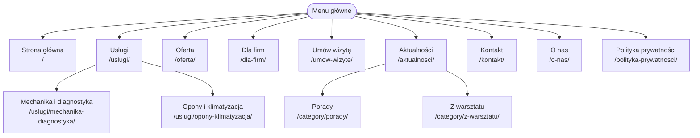

# Auto-Serwis Waldi

*Nazwa* - Auto-Serwis Waldi
*Oferta* - Naprawa oraz diagnostyka samochodów osobowych i dostawczych do 3.5t
*Grupa docelowa* - Klienci prywatni oraz małe firmy.

## Persony
### Klient prywatny
- **Cel** - Umówić się na diagnostykę, kontrolki silnika.
- **Problem** - Nie ma czasu zadzwonić w godzinach pracy warsztatu.
- **Urządzenie** - smartfon.
- **CTA** - **"Umów wizytę online"**

### Klient flotowy
- **Cel** - Partnerstwo z warsztatem który będzie dbał o flotę.
- **Problem** - Samochody jeżdżą do różnych warsztatów, co stwarza problemy z organizacją.
- **Urządzenie** - Komputer w biurze.
- **CTA** - **"Zapytaj o ofertę dla firm"**

## Mapa strony

## Struktura treści
- **Bezpośrednie odnośniki** - `/%postname%/` (nazwa wpisu).
- **Strona główna** - statyczna (`/`), wpisy na stronie **Aktualności** (Ustawienia > Czytanie).
- **Kategorie** - Porady, Z warsztatu.
- **Wpisy** - „Kontrolka check engine – co oznacza i co zrobić?” (Porady), „Przygotuj auto do zimy” (Porady), „Rezerwacja wizyt online – wkrótce” (Z warsztatu).

## Strona główna (według `wireframe.svg`)
| Sekcja | Bloki |
|---|---|
| Hero | Okładka → Tytuł (H1), Akapit, Przyciski (CTA „Umów wizytę online”) |
| Usługi i korzyści | Grupa → H2, Kolumny (3 × karta: H3, Lista, link) – wcześniej Tabela, zamieniona po audycie WAVE (*Layout table*) |
| Opinie klientów | Grupa → H2, Kolumny (3 × Grupa-karta z Cytatem) – przykładowe opinie, oznaczone na stronie jako wygenerowane przez AI |

Jeden H1, kolejność nagłówków H1 → H2 → H3. Szablon „Strona bez tytułu”, żeby tytuł strony nie dublował H1.

## Nagłówek, stopka i wzorzec
- **Nagłówek** - logo + nazwa witryny, Nawigacja „Menu główne” (Strona główna, Usługi z podstronami, Dla firm, Aktualności, Kontakt), przycisk „Umów wizytę”.
- **Stopka** - nazwa i slogan, dane kontaktowe (adres, telefon, e-mail, godziny otwarcia), „Menu stopki” z linkiem do Polityki prywatności.
- **Wzorzec** - „Hero – Auto-Serwis Waldi” (niezsynchronizowany, kategoria Auto-Serwis), zapisany z Okładki strony głównej i wstawiony na stronie **Oferta** (`/oferta/`). Blok Tytuł w Okładce pokazuje tytuł danej strony jako H1.

## Dlaczego WordPress
Super popularny, słyszałem i spotkałem się z WordPressem, jeszcze zanim rozpocząłem studia. Z doświadczenia z Open Source, za popularnością idzie także bezpieczeństwo i ilość motywów/pluginów. Łatwość uruchomienia i konfiguracji.

## Użycie AI w projekcie
**Narzędzie:** Claude Code (Anthropic) – asystent w terminalu z dostępem do repozytorium i lokalnego WordPressa.

**Moje decyzje i praca:** persony, mapa strony, układ strony głównej (Okładka ze zdjęciem, usługi, opinie), wybór palety (mój motyw Spectagon) i zdjęcia z Pexels, ocena kolejnych wersji i poprawki wyglądu (m.in. odrzucona pierwsza wersja strony głównej, wyśrodkowanie i rozmiar tekstu na stronie Usługi), audyt WAVE, przegląd i akceptacja zmian.

**Do czego użyłem AI:**
- wygenerowanie pliku `wireframe.svg` i ogólna pomoc,
- teksty pomocnicze: 3 wpisy w Aktualnościach, opisy na stronach Usługi, Oferta i Kontakt, szkic polityki prywatności (do weryfikacji – firma i dane są fikcyjne),
- przykładowe opinie klientów (oznaczone na stronie),
- kod: plik wzorca `patterns/hero-cta.php`, `theme.json`, Dodatkowy CSS, formularz CF7 z komunikatami,
- obliczenia kontrastu, uruchomienie Lighthouse (pliki w [`raport/`](raport/), podsumowanie [`lighthouse-podsumowanie.md`](raport/lighthouse-podsumowanie.md)) i poprawki zgłoszone przez Lighthouse/WAVE,
- pomoc w redakcji tego README (tabele, lista źródeł, opis B1).

**Weryfikacja:** zmiany sprawdzane w przeglądarce i na zrzutach ekranu (komputer i telefon); wyniki audytów są w [`raport/`](raport/) (opis zawartości: [`raport/README.md`](raport/README.md)). Plik `raport/lighthouse/pierwszy-testowy-pomiar.html` to mój pierwszy, testowy pomiar stanu po zmianach.

## Style globalne i kontrast (L3 G1)
Paleta na bazie mojego motywu terminala/edytora **Monokai Pro Spectagon** (ciemne tło Spectrum + akcenty Octagon, plik `nixconfig-global`). Pomarańcz marki pasuje do zdjęcia warsztatu. Ten sam zapis w [`theme.json`](theme.json) (do motywu w L4).

| Kolor | Slug | Wartość |
|---|---|---|
| Tło | `base` | `#222222` |
| Tekst | `contrast` | `#EAF2F1` |
| Marka (pomarańcz) | `accent-1` | `#FF9B5E` |
| Tekst drugorzędny | `accent-4` | `#B2B9BD` |
| Akcent – tło kart | `accent-5` | `#363537` |
| Obramowania (techniczny) | `accent-6` | `#696D77` |

| Para tekst / tło | Kolory | Kontrast | WCAG AA |
|---|---|---|---|
| Nagłówki / tło | `#EAF2F1` / `#222222` | 13,99:1 | ✅ |
| Tekst akapitu / tło | `#B2B9BD` / `#222222` | 8,01:1 | ✅ |
| Tekst w kartach opinii / tło kart | `#B2B9BD` / `#363537` | 6,14:1 | ✅ |
| Przycisk: tekst / kolor marki | `#222222` / `#FF9B5E` | 7,65:1 | ✅ (jasny tekst na pomarańczu nie przeszedłby – zmieniony na ciemny) |
| Stopka: tekst / tło | `#EAF2F1` / `#131313` | 16,34:1 | ✅ |
| Obramowania / tło (element UI, wymóg 3:1) | `#696D77` / `#222222` | 3,07:1 | ✅ |
| Okładka: biały tekst / nakładka | `#FFFFFF` / `#393232` (50%) | 12,53:1* | ✅ |

\* dla samej nakładki; na jaśniejszych fragmentach zdjęcia kontrast jest niższy – sprawdzić w Lighthouse (G3).

## Źródła i licencje materiałów (L3 G4)

| Materiał | Gdzie użyty | Autor | Licencja | Link |
|---|---|---|---|---|
| Zdjęcie „Mechanicy przy samochodach w warsztacie” | Okładka strony głównej, strona Oferta, wzorzec `hero-cta` | Quentin Martinez | [Licencja Pexels](https://www.pexels.com/license/) – darmowe użycie, bez obowiązku podpisu | [pexels.com/photo/33169327](https://www.pexels.com/photo/33169327/) · [autor](https://www.pexels.com/@quentin-martinez-2147503099/) |
| Font Manrope | Cały tekst strony | The Manrope Project Authors | SIL Open Font License 1.1 | [github.com/sharanda/manrope](https://github.com/sharanda/manrope) |
| Font Fira Code | Bloki kodu | The Fira Code Project Authors | SIL Open Font License 1.1 | [github.com/tonsky/FiraCode](https://github.com/tonsky/FiraCode) |
| WordPress | CMS | WordPress.org | GPLv2 lub nowsza | [wordpress.org](https://wordpress.org/) |
| Motyw Twenty Twenty-Five 1.5 | Motyw witryny | the WordPress team | GPLv2 lub nowsza | [wordpress.org/themes/twentytwentyfive](https://wordpress.org/themes/twentytwentyfive/) |
| Wtyczka Contact Form 7 6.2.5 | Formularze | Rock Lobster Inc. | GPLv2 lub nowsza | [contactform7.com](https://contactform7.com/) |
| Wtyczka Bookly 28.8 | **Wyłączona** – niezgodna z bazą SQLite (Playground): instalator tworzy tylko 19 z ok. 34 tabel, kreator konfiguracji kończy się błędem; rezerwacja online „wkrótce” | Nota-Info | GPLv3 | [wordpress.org/plugins/bookly-responsive-appointment-booking-tool](https://wordpress.org/plugins/bookly-responsive-appointment-booking-tool/) |
| Wtyczka SQLite Database Integration 3.1.3 | Baza danych (WordPress Playground) | The WordPress Team | GPLv2 lub nowsza | [wordpress.org/plugins/sqlite-database-integration](https://wordpress.org/plugins/sqlite-database-integration/) |
| Paleta kolorów | Style globalne, `theme.json` | na bazie motywu Monokai Pro (filtr „Spectagon” – własna mieszanka Spectrum + Octagon) | kolory, nie podlegają licencji | – |

**Fonty hostowane lokalnie** – Manrope i Fira Code są dostarczane z motywem (`themes/twentytwentyfive/assets/fonts/`) i ładowane z serwera strony; strona nie łączy się z Google Fonts (RODO).

## Dostępny formularz kontaktowy (L3 B1)
Formularz Contact Form 7 na stronie [Kontakt](/kontakt/), zbudowany według startera.

- **Widoczne etykiety** – każde pole jest w `<label>`, wymagane pola oznaczone **tekstem** („(wymagane)”), nie tylko gwiazdką czy kolorem; dodatkowo `aria-required="true"`.
- **Autouzupełnianie** – `autocomplete="name"`, `"email"`, `"tel"` (WCAG 1.3.5 Określenie pożądanego wkładu).
- **Zgoda RODO** – pole `[acceptance]` **niezaznaczone domyślnie**, z linkiem do polityki prywatności. Ustawienie `acceptance_as_validation: on`: przycisk „Wyślij” jest zawsze aktywny, a brak zgody daje komunikat błędu (domyślnie CF7 wyłącza przycisk – wyłączony przycisk jest pomijany przez klawisz Tab i nie mówi, czego brakuje).
- **Komunikaty błędów po polsku i z podpowiedzią** (WCAG 3.3.1, 3.3.3) – np. „Wpisz poprawny adres e-mail, np. jan@przyklad.pl.”, „Aby wysłać wiadomość, zaznacz zgodę na przetwarzanie danych.” Kolor błędów `#FF657A` (5,6:1 na tle `#222222`) zamiast domyślnego `#DC3232` (3,44:1 – nie spełniał 4,5:1), a pole z błędem dostaje grubszą ramkę – informacja nie zależy tylko od koloru.
- **Test** – walidacja sprawdzona wysłaniem pustego formularza, błędnego e-maila, braku zgody i poprawnych danych; Lighthouse (axe-core) dla strony Kontakt: 100/100.
- **Tryb demo** – lokalny kontener nie ma serwera poczty, więc formularz ma `demo_mode: on` (pomija wysyłkę e-maila). Na produkcji należy to usunąć i skonfigurować SMTP.

**WCAG 3.3.8 Accessible Authentication (Minimum)** – formularz nie wymaga żadnego testu poznawczego: nie ma CAPTCHA z przepisywaniem znaków, łamigłówki, zadania matematycznego ani pytania-quizu CF7. Pola można wypełniać autouzupełnianiem i wklejać do nich tekst. Ochrona przed spamem: na razie tylko lista zabronionych słów z WordPressa (Ustawienia > Dyskusja), którą sprawdza CF7. Do zrobienia na produkcji: pole-pułapka (np. wtyczka „Honeypot for Contact Form 7”) albo Akismet / Cloudflare Turnstile w trybie niewidocznym – żadne z nich nie wymaga od użytkownika testu poznawczego.

**WCAG 2.5.8 Target Size (Minimum)** – pola tekstowe i przycisk mają min. 44 px wysokości, pole zgody 24×24 px, a link do polityki prywatności jest w tekście zdania (wyjątek „inline” w kryterium). Wszystkie cele mają co najmniej 24×24 px.

