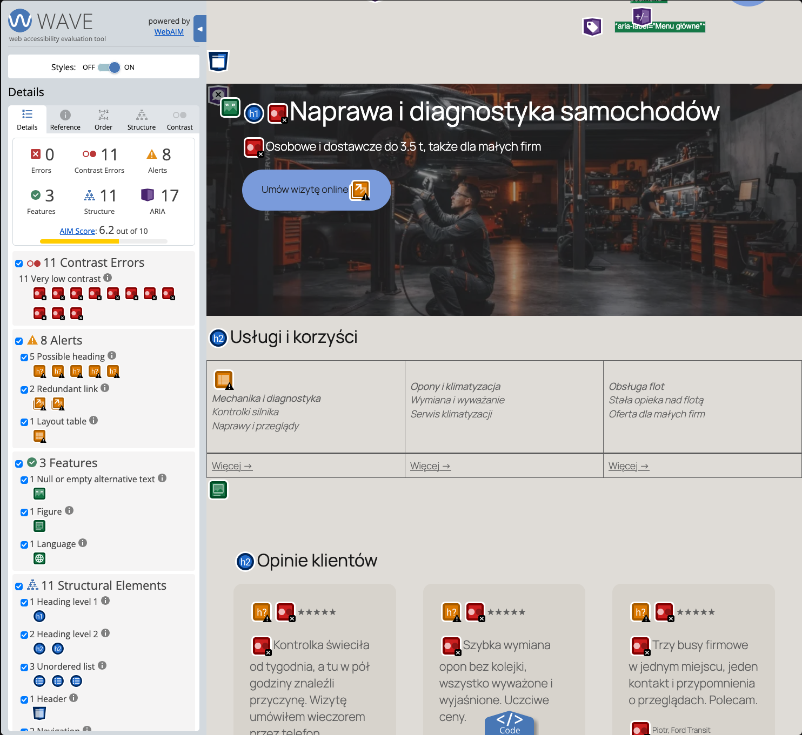
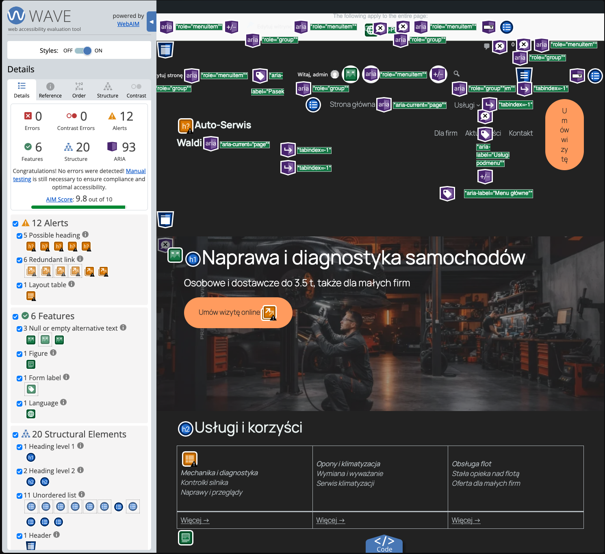
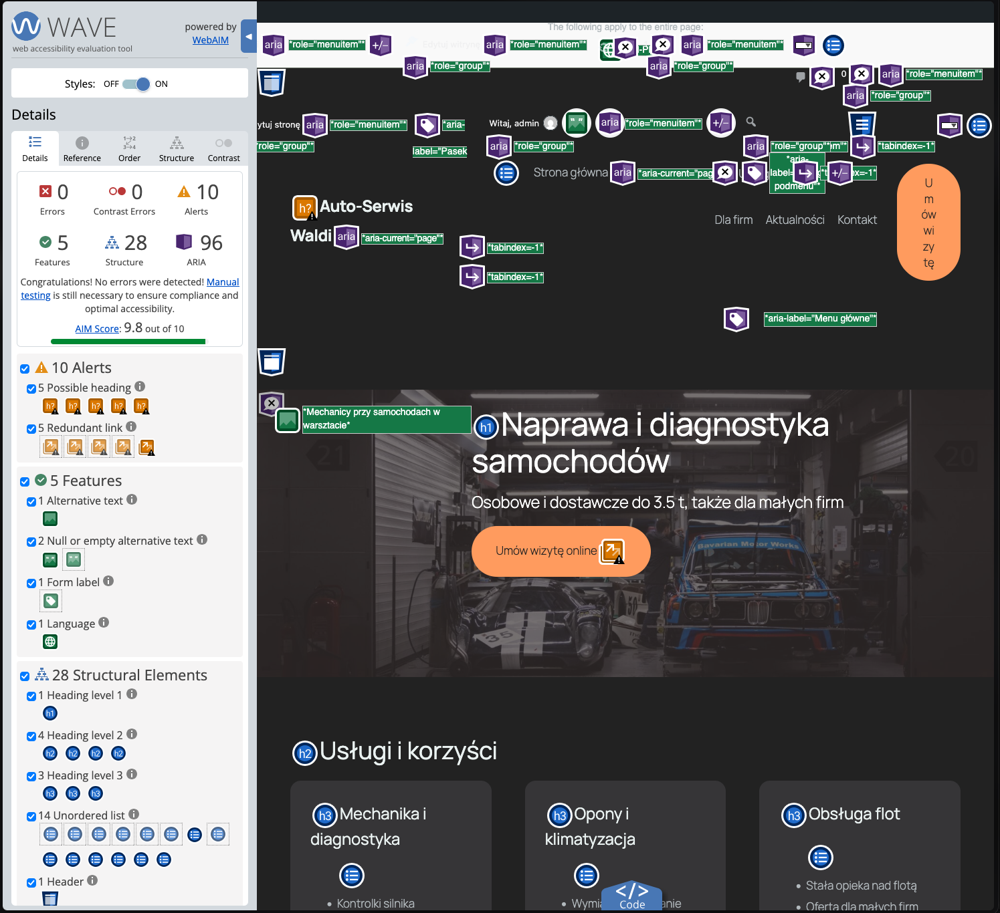

# Lighthouse – Dostępność: przed i po (L3 G3)

Narzędzia: Lighthouse 13.6.0, axe-core 4.11 (przez pa11y / Puppeteer – darmowy silnik axe DevTools), WAVE (rozszerzenie przeglądarki).

- **Przed** – stan sprzed L3 (kopia bazy, uruchomiona na `localhost:8082`)
- **Po** – stan po L3 (paleta Spectagon, Dodatkowy CSS, poprawki z WAVE, formularz kontaktowy) na `localhost:8081`
- Lighthouse 13.6.0, kategoria Accessibility, Chrome for Testing (headless)

## Wyniki

| Strona | Urządzenie | Przed | Po | Raport przed | Raport po |
|---|---|---|---|---|---|
| Strona główna | Telefon | 96 | **100** ⬆️ | [przed](lighthouse/przed/glowna-mobile.report.html) | [po](lighthouse/po/glowna-mobile.report.html) |
| Strona główna | Komputer | 96 | **100** ⬆️ | [przed](lighthouse/przed/glowna-desktop.report.html) | [po](lighthouse/po/glowna-desktop.report.html) |
| Usługi | Telefon | 100 | **100** | [przed](lighthouse/przed/uslugi-mobile.report.html) | [po](lighthouse/po/uslugi-mobile.report.html) |
| Usługi | Komputer | 100 | **100** | [przed](lighthouse/przed/uslugi-desktop.report.html) | [po](lighthouse/po/uslugi-desktop.report.html) |
| Kontakt | Telefon | 100 | **100** | [przed](lighthouse/przed/kontakt-mobile.report.html) | [po](lighthouse/po/kontakt-mobile.report.html) |
| Kontakt | Komputer | 100 | **100** | [przed](lighthouse/przed/kontakt-desktop.report.html) | [po](lighthouse/po/kontakt-desktop.report.html) |

## Szczegóły (wszystkie 12 raportów)

### Strona główna · Telefon · przed – 96/100
- Zaliczone testy automatyczne: 24
- ❌ **Background and foreground colors do not have a sufficient contrast ratio.** (`color-contrast`) – 6 elementów
- Do ręcznego sprawdzenia: 10 pozycji

### Strona główna · Telefon · po – 100/100
- Zaliczone testy automatyczne: 21
- ✅ Brak błędów wykrytych automatycznie
- Do ręcznego sprawdzenia: 10 pozycji

### Strona główna · Komputer · przed – 96/100
- Zaliczone testy automatyczne: 25
- ❌ **Background and foreground colors do not have a sufficient contrast ratio.** (`color-contrast`) – 6 elementów
- Do ręcznego sprawdzenia: 10 pozycji

### Strona główna · Komputer · po – 100/100
- Zaliczone testy automatyczne: 22
- ✅ Brak błędów wykrytych automatycznie
- Do ręcznego sprawdzenia: 10 pozycji

### Usługi · Telefon · przed – 100/100
- Zaliczone testy automatyczne: 22
- ✅ Brak błędów wykrytych automatycznie
- Do ręcznego sprawdzenia: 10 pozycji

### Usługi · Telefon · po – 100/100
- Zaliczone testy automatyczne: 20
- ✅ Brak błędów wykrytych automatycznie
- Do ręcznego sprawdzenia: 10 pozycji

### Usługi · Komputer · przed – 100/100
- Zaliczone testy automatyczne: 23
- ✅ Brak błędów wykrytych automatycznie
- Do ręcznego sprawdzenia: 10 pozycji

### Usługi · Komputer · po – 100/100
- Zaliczone testy automatyczne: 21
- ✅ Brak błędów wykrytych automatycznie
- Do ręcznego sprawdzenia: 10 pozycji

### Kontakt · Telefon · przed – 100/100
- Zaliczone testy automatyczne: 21
- ✅ Brak błędów wykrytych automatycznie
- Do ręcznego sprawdzenia: 10 pozycji

### Kontakt · Telefon · po – 100/100
- Zaliczone testy automatyczne: 28
- ✅ Brak błędów wykrytych automatycznie
- Do ręcznego sprawdzenia: 10 pozycji

### Kontakt · Komputer · przed – 100/100
- Zaliczone testy automatyczne: 22
- ✅ Brak błędów wykrytych automatycznie
- Do ręcznego sprawdzenia: 10 pozycji

### Kontakt · Komputer · po – 100/100
- Zaliczone testy automatyczne: 29
- ✅ Brak błędów wykrytych automatycznie
- Do ręcznego sprawdzenia: 10 pozycji

## Naprawione błędy (Lighthouse + WAVE)

| Błąd | Kryterium WCAG | Przed | Po | Poprawka |
|---|---|---|---|---|
| Za słaby kontrast tekstu i podpisów w kartach opinii (6 elementów) | 1.4.3 Kontrast (minimum) | `#5F5F5F` / `#D7D3CC` = 4,28:1 | `#B2B9BD` / `#363537` = 6,14:1 | Nowa paleta w Stylach globalnych (Spectagon) |
| WAVE: *Layout table* – tabela użyta do ułożenia 3 usług | 1.3.1 Informacje i relacje | Blok Tabela (3 kolumny + wiersz z linkami) | Blok Kolumny z 3 kartami (Grupa) | Tabela zamieniona na Kolumny |
| WAVE: *Possible heading* – pogrubiony tekst udający nagłówek (nazwy usług, „Kontakt”, „Na skróty” w stopce) | 1.3.1 Informacje i relacje | `<strong><em>` / `
<strong>` | H3 w kartach usług, H2 w stopce | Akapity zamienione na bloki Nagłówek |
| WAVE: *Redundant link* – dwa sąsiednie linki do Polityki prywatności w stopce | 2.4.4 Cel linku (w kontekście) | Menu stopki + link w linii © | Tylko menu stopki | Usunięty zdublowany link |
| Niejasne linki „Więcej →” (3×) | 2.4.4 Cel linku (w kontekście) | „Więcej →” | „Więcej o diagnostyce →”, „Więcej o oponach i klimie →”, „Oferta dla firm →” | Opisowe teksty linków |
| axe: tekst na zdjęciu Okładki – kontrast do ręcznej oceny; pomiar pikseli pod tekstem: H1 2,85:1, akapit na telefonie 2,94:1 | 1.4.3 Kontrast (minimum) | nakładka 50% | nakładka 70% – najgorszy piksel ≥ 4,89:1 | Większe przyciemnienie Okładki |
| axe: strzałka podmenu „Usługi” 10×10 px | 2.5.8 Rozmiar celu (minimum) | 10×10 px | 24×24 px | CSS w Dodatkowym CSS |
| axe: gwiazdki ★★★★★ bez tekstu – czytnik czyta „czarna gwiazda” ×5 | 1.1.1 Treść nietekstowa | ★★★★★ | `★★★★★ 5/5` | Ocena tekstem |

## Czego Lighthouse nie wykrył

- Strona Usługi przed zmianami miała rozjechany układ (wąska kolumna, tekst łamany co 2 słowa) – wynik i tak 100.
- Strona Kontakt „przed” miała 100, bo była pusta. „Po” ma formularz CF7 (L3 B1) – nadal 100.
- Linki „Więcej →”, tabela układu, „udawane” nagłówki i zdublowany link – wszystko to znalazł dopiero WAVE (alerty), Lighthouse dawał 100.
- Widoczność fokusu (2.4.7) i sensowność tekstów alternatywnych – do sprawdzenia ręcznie i w WAVE.

## axe-core – wynik końcowy

| Strona | Komputer | Telefon |
|---|---|---|
| Strona główna | 0 naruszeń | 0 naruszeń |
| Usługi | 0 naruszeń | 0 naruszeń |
| Oferta | 0 naruszeń | 0 naruszeń |
| Kontakt | 0 naruszeń | 0 naruszeń |

Pozycje „do sprawdzenia ręcznie” (axe nie potrafi ich ocenić automatycznie) – sprawdzone:
- tekst na zdjęciu Okładki – zmierzony na zrzucie z ukrytym tekstem (najjaśniejszy piksel pod tekstem), po poprawce ≥ 4,89:1,
- etykieta zgody RODO obok pola wyboru – tekst `#EAF2F1` na `#222222` = 13,99:1,
- gwiazdki – symbole ukryte przed czytnikiem, ocena podana tekstem „5/5”.

## WAVE – przed i po

**Przed**

**Po poprawkach z WAVE**

**Po poprawkach z axe (stan końcowy)** – 0 błędów, 0 błędów kontrastu, AIM Score 9,8/10. Pozostałe alerty: *Possible heading* (m.in. pogrubiona nazwa witryny w nagłówku – celowo nie jest nagłówkiem, jedyny H1 jest w Okładce) i *Redundant link* (np. nazwa witryny i „Strona główna” prowadzą pod ten sam adres; przycisk „Umów wizytę” w nagłówku i CTA w Okładce). Pomiar wykonany po zalogowaniu – część oznaczeń dotyczy paska administratora WordPressa, którego odwiedzający nie widzą.

